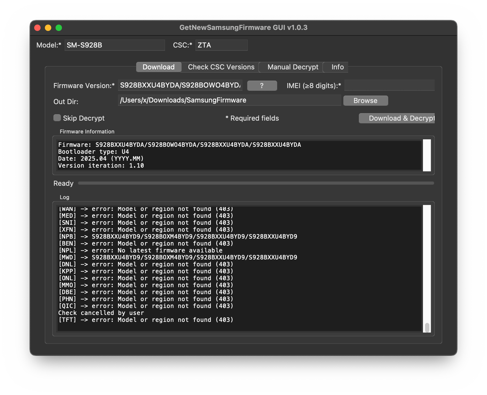

# GNSF – Get New Samsung Firmware


Hey there! 👋  

Want the latest Samsung firmware for **Odin** and decrypt it without jumping through hoops? That's exactly why I built **GNSF**. It helps you:

- Fetch the newest firmware for your Samsung model/region — phones, tablets **and Galaxy Watch**
- Download it with automatic resume
- Auto-decrypt `.enc2`/`.enc4` packages

All in one go, **no IMEI or serial number needed**:

```bash
./gnsf.py -m SM-S928B -r XSA download -O ./downloads
./gnsf.py -m SM-L310 -r XSG download -O ./downloads   # Galaxy Watch7
```

Project URL: https://github.com/keklick1337/gnsf

## Ready-to-use Applications

| Platform | GUI Version | CLI Version |
|----------|-------------|-------------|
| Windows x64 | [](https://github.com/keklick1337/gnsf/releases/latest/download/windows_x64_gnsf-GUI.exe) | [](https://github.com/keklick1337/gnsf/releases/latest/download/windows_x64_gnsf.exe) |
| macOS ARM64 | [](https://github.com/keklick1337/gnsf/releases/latest/download/GetNewSamsungFirmware-macOS-arm64.dmg) | [](https://github.com/keklick1337/gnsf/releases/latest/download/macos_arm64_gnsf) |

---

## Features

- 🔍 `check` – latest firmware for one region (or all known regions), optionally with older versions
- ⬇️ `download` – download and decrypt firmware in one step
- 🔐 `decrypt` – manual decryption of `.enc2` / `.enc4` files
- ⌚ Galaxy Watch support
- ↪️ Interrupted downloads are resumed automatically (also on network errors)
- 🖥️ GUI and CLI versions

---

## Requirements

- Python 3.7+
- [`pycryptodome`](https://pypi.org/project/pycryptodome/) – the only dependency
- Tkinter for the GUI (included with most Python installations)

## Installation

```bash
git clone https://github.com/keklick1337/gnsf.git
cd gnsf
pip install -r requirements.txt
```

---

## Usage

```bash
python gnsf.py -m <MODEL> -r <CSC> <command> [options]
```

### check

```bash
# Single region
./gnsf.py -m SM-S928B -r XSA check

# Single region with older published versions
./gnsf.py -m SM-S928B -r XSA check -a

# All known regions (only regions with firmware are printed)
./gnsf.py -m SM-S928B check
```

### download

```bash
./gnsf.py -m SM-S928B -r XSA download -O ./downloads
# -v <version>   firmware version; omit for latest. Accepts the full PDA/CSC/MODEM
#                string or one part of it (e.g. the CSC code from 'check -a')
# --no-decrypt   keep the encrypted .enc2/.enc4 file
```

Run the same command again after an interruption and the download continues where it stopped.

### decrypt

```bash
./gnsf.py -m SM-S928B -r XSA decrypt \
  -v S928BXXU6EZIF/S928BOXM6EZIF/S928BXXU6EZIF/S928BXXU6EZIF \
  -i firmware.zip.enc4 \
  -o firmware.zip
# -V 2|4 forces the encryption version (detected from the file name by default)
# -o defaults to the input file name without .encN
```

---

## GUI



```bash
python3 gnsf-GUI.py
```

On Linux you may need Tkinter first, e.g. `sudo apt-get install python3-tk`.

- Check firmware across all regions, double-click a result to download it
- Download progress with speed and ETA, cancel and resume any time
- Manual decrypt tab
- Opens the download folder when finished

---

## Building

| Target | Command | Output |
|--------|---------|--------|
| Windows | `tools\windows_build.bat` | `dist\windows_x64_gnsf.exe` (CLI), `dist\windows_x64_gnsf-GUI.exe` (GUI) |
| Windows (via Wine, on Linux or macOS) | `tools/wine_windows_build.sh` | `dist/windows_x64_gnsf.exe` (CLI), `dist/windows_x64_gnsf-GUI.exe` (GUI) |
| macOS | `tools/macos_arm_build.sh` | `dist/macos_<arch>_gnsf` (CLI), `dist/GetNewSamsungFirmware-macOS-<arch>.dmg` (GUI) |

The Windows build needs Python 3 from python.org (`py` launcher or `python` on PATH); run the `.bat` from any directory.
The Wine build needs Windows Python installed in the Wine prefix (`python.exe` on the Wine path, or set `WINE_PYTHON`). Use `WINE=/path/to/wine` to pick a specific Wine binary.

---

## Handy Tips

- Some regions don't carry a package for every model (the server answers `S01`) — just try another region from `check`.
- The `-i`/`-s` (IMEI / serial number) options from older versions are still accepted but no longer needed.

---

## Project layout

```
gnsf.py              CLI entry point
gnsf-GUI.py          GUI entry point
gnsflib/fus.py       Samsung FUS protocol: auth, firmware info, download
gnsflib/core.py      download / decrypt / check logic shared by CLI and GUI
gnsflib/firmware.py  firmware version parsing
gnsflib/cli.py       command-line interface
gnsflib/gui.py       Tkinter interface
gnsflib/csc.py       CSC region list
```

---

## Contributing

Found a bug or wanna add a cool feature? PRs are welcome! Just fork, hack away, and send a pull request.  
Please keep the code style consistent.

## Credits

The current FUS protocol (Smart Switch endpoints, nonce signing) follows [samloader-rs](https://github.com/topjohnwu/samloader-rs) by topjohnwu.

## License

This project is MIT‑licensed. See the [LICENSE](LICENSE) file for details.

---

Happy flashing! 🚀

---

## Additional Resources

### Samsung Firmware Monitor

- 🌐 **[Samsung Firmware Monitor](https://samsung-firmware.trustcrypt.com/)** – browse and monitor the latest firmware releases for any Samsung device model.

This resource complements GNSF by letting you:
- Check available firmware versions across multiple devices at once
- Monitor when new firmware gets released
- View firmware details before downloading
